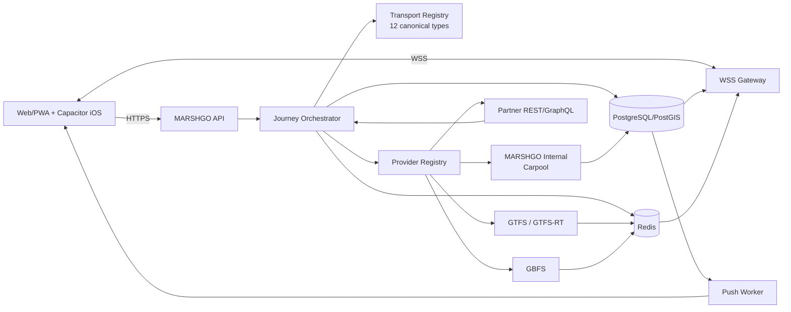

# MARSHGO — Консолідоване production-ready ТЗ інтеграції 12 канонічних видів транспорту

**Дата затвердження:** 10 жовтня 2026 року
**Статус:** APPROVED / PRODUCTION INTEGRATION CONTRACT
**Обсяг:** Вебінтерфейс, API, Journey Engine, карта (MapLibre), адмінпанель, iOS-wrapper, БД та провайдери.

---

## 1. Резюме продуктового рішення

Станом на 10 жовтня 2026 року продуктове рішення MARSHGO зафіксоване однозначно: у вебінтерфейсі, API, Journey Engine, карті, адмінпанелі та iOS-wrapper повинно існувати **рівно 12 користувацьких транспортних категорій** і саме в цьому порядку:

| Порядок | Назва uk-UA | Canonical ID | Що входить |
|:---:|---|---|---|
| 1 | Автобуси | `bus` | Міські, приміські та міжміські автобуси |
| 2 | Маршрутки | `marshrutka` | Маршрутні таксі / мікроавтобуси |
| 3 | Тролейбуси | `trolleybus` | Тролейбусні маршрути |
| 4 | Трамваї | `tram` | Трамвайні маршрути |
| 5 | Метро | `metro` | Метрополітен |
| 6 | Попутки | `carpool` | Власний community marketplace MARSHGO |
| 7 | Таксі | `taxi` | Контрактні ride-hailing/taxi-провайдери |
| 8 | Поїзди | `train` | Далекі, регіональні, міські поїзди та електрички |
| 9 | Велосипеди | `bike` | Власний велосипед + прокатні/e-bike як один UI-тип |
| 10 | Самокати | `scooter` | Звичайні/електросамокати в межах одного UI-типу |
| 11 | Каршеринг | `carsharing` | Короткострокова оренда автомобілів |
| 12 | Трансфери | `transfer` | Попередньо замовлені приватні/партнерські трансфери |

### Ключові правила таксономії
- `walk` **не є тринадцятим транспортом**: це внутрішній Journey leg для first/last mile і пересадок.
- `all` (`Усі`) — це **стан вибору**, а не транспорт.
- `suburban_train`, `city_train`, `intercity_bus`, `ebike`, `moped`, `car_rental`, `funicular`, `plane`, `ferry` та інші legacy-ідентифікатори **не повинні** породжувати додаткові основні кнопки.
- Канон MARSHGO вимагає:
  - одного A→B пошуку,
  - одного Journey Engine,
  - одного формату результатів,
  - однієї спільної карти (MapLibre).
- **Availability конкретної категорії** визначається центральним серверним реєстром за містом та провайдерами.

### Архітектурна теза
Дванадцять категорій — це продуктова таксономія, а не дванадцять окремих backend-систем. Frontend завжди працює з єдиним контрактом Journey, а backend через `TransportAdapter`/`ProviderAdapter` нормалізує GTFS, GTFS-Realtime, GBFS, MARSHGO internal API і комерційні partner API в один домен.



### Основний принцип production availability
```
Категорія існує у каноні
          ≠
Категорія доступна у конкретному місті
          ≠
Є schedule data
          ≠
Є realtime
          ≠
Можна забронювати
          ≠
Можна купити квиток у MARSHGO
```
Frontend отримує ці можливості окремими capability flags і ніколи не домислює їх.

---

## 2. Канонічна матриця транспортів, протоколів і українських джерел

| Тип | Search / availability | Realtime | Booking / ticketing | Базовий протокол | Пріоритетні українські джерела | Інтеграційна складність |
|---|---|---|---|---|---|:---:|
| `bus` | GTFS schedule + intercity inventory | GTFS-RT vehicle/trip/alerts | Міський: часто NONE/EXTERNAL; міжміський: partner API | GTFS, GTFS-RT, REST | Офіційні муніципальні feeds; контрактні Uklon Travel / INFOBUS-подібні системи | High |
| `marshrutka` | GTFS/provider mapping | GTFS-RT або partner GPS | Залежить від оператора | GTFS + REST | Муніципальні routeTaxi/перевізники | High |
| `trolleybus` | GTFS | GTFS-RT | Зазвичай без seat reservation | GTFS, GTFS-RT | Муніципальні відкриті дані | Medium |
| `tram` | GTFS | GTFS-RT | Зазвичай без seat reservation | GTFS, GTFS-RT | Муніципальні відкриті дані | Medium |
| `metro` | Schedule/stations/service state | Trip/service data; vehicle positions тільки якщо реально є | Міський fare/external | GTFS/municipal API | Офіційні міські джерела | Medium–High |
| `carpool` | Власний PostGIS search | MARSHGO GPS, booking state | Повне in-app бронювання | MARSHGO REST + WSS | MARSHGO | High, але контрольована |
| `taxi` | Quote + ETA + classes | Assigned driver only | Dispatch/in-app або external | Partner REST/GraphQL/Webhooks | Uklon як пріоритетний український кандидат | High |
| `train` | Timetable + inventory | Delays/platform/service updates | External UZ або contracted API | Partner REST; GTFS лише як licensed schedule source | Укрзалізниця | High |
| `bike` | Routing + shared-bike nearby | GBFS station/vehicle | Own bike: none; rental: deep link/API | Routing + GBFS | Офіційні/контрактні bike-sharing feeds | Medium |
| `scooter` | Nearby asset + geofence | GBFS/partner positions | Deep link/reservation partner API | GBFS + REST | Uklon Scooters/e-Wings, 3electra, інші contractual feeds | Medium |
| `carsharing` | Nearby cars, zone, rate | Fleet availability | Reservation, external/in-app | Partner REST/Webhooks | Getmancar як український кандидат | High |
| `transfer` | Availability/quote | Assigned driver after booking | Scheduled reservation | Partner REST/GraphQL/Webhooks | Ліцензовані партнерські оператори | High |

### Обов'язкові capabilities для Provider Registry:
```
SEARCH
SCHEDULE
AVAILABILITY
TRANSIT_ROUTES
TRANSIT_STOPS
REALTIME_POSITION
REALTIME_ETA
SERVICE_ALERTS

PRICE_ESTIMATE
PRICE_LOCK
FARE_INFO

BOOK_IN_APP
RESERVATION
CANCEL
EXTERNAL_BOOKING
TICKET_ISSUE
TICKET_REFUND

ASSET_DISCOVERY
STATION_STATUS
GEOFENCING

ASSIGNED_DRIVER
ASSIGNED_DRIVER_POSITION

PROVIDER_ATTRIBUTION
```

---

## 3. API, база даних, контракти та realtime

### API Endpoints
| Endpoint | bus | marshrutka | trolleybus | tram | metro | carpool | taxi | train | bike | scooter | carsharing | transfer |
|---|:---:|:---:|:---:|:---:|:---:|:---:|:---:|:---:|:---:|:---:|:---:|:---:|
| `GET /catalog/transport-types?cityId=` | ✓ | ✓ | ✓ | ✓ | ✓ | ✓ | ✓ | ✓ | ✓ | ✓ | ✓ | ✓ |
| `POST /journeys/search` | ✓ | ✓ | ✓ | ✓ | ✓ | ✓ | ✓ | ✓ | ✓ | ✓ | ✓ | ✓ |
| `GET /journeys/searches/:id` | ✓ | ✓ | ✓ | ✓ | ✓ | ✓ | ✓ | ✓ | ✓ | ✓ | ✓ | ✓ |
| `GET /journeys/:id` | ✓ | ✓ | ✓ | ✓ | ✓ | ✓ | ✓ | ✓ | ✓ | ✓ | ✓ | ✓ |
| `GET /transport/routes` | ✓ | ✓ | ✓ | ✓ | ✓ | route result | — | ✓ | cycling infra | — | — | — |
| `GET /transport/stops` | ✓ | ✓ | ✓ | ✓ | ✓ | — | — | ✓ stations | — | — | — | — |
| `GET /transport/vehicles` | live | live | live | live | live | ні (public) | ні (public) | якщо feed | — | — | — | ні (public) |
| `GET /mobility/assets` | — | — | — | — | — | — | — | — | shared bike | ✓ | ✓ | — |
| `POST /bookings` | partner | partner | no | no | no | ✓ | partner | partner | opt | opt | partner | partner |
| `POST /booking-handoffs` | ✓ | ✓ | —/✓ | —/✓ | ✓ | — | ✓ | ✓ | ✓ | ✓ | ✓ | ✓ |
| `POST /bookings/:id/cancel` | cap | cap | — | — | — | ✓ | cap | cap | cap | cap | cap | cap |
| `GET /bookings/:id/live` | — | — | — | — | — | auth | auth | — | — | — | auth | auth |
| `WSS live topic` | transit | transit | transit | transit | transit | booking | booking | transit | asset | asset | asset/res | booking |

> [!CAUTION]
> `/transport/vehicles` **ніколи** не повинен повертати приватну позицію конкретного taxi/carpool/transfer водія. Після бронювання live location відкривається лише учасникам через scoped endpoint / WSS.

### Єдиний контракт пошуку
`POST /api/v1/journeys/search`
```json
{
  "origin": { "name": "Львів, площа Ринок", "lat": 49.8418, "lon": 24.0316, "placeId": "place_01" },
  "destination": { "name": "Львів, Головний вокзал", "lat": 49.8391, "lon": 23.9945, "placeId": "place_02" },
  "timeMode": "DEPART_AT",
  "departureAt": "2026-10-10T18:30:00+03:00",
  "passengers": 1,
  "transportTypes": ["bus", "marshrutka", "tram", "carpool", "taxi"],
  "strategy": "BALANCED",
  "filters": { "maxWalkingMeters": 1500, "maxTransfers": 2, "maxPriceMinor": 50000 },
  "locale": "uk-UA",
  "timezone": "Europe/Kyiv"
}
```

Response:
```json
{
  "data": {
    "searchId": "search_01J...",
    "status": "PARTIAL",
    "version": 3,
    "providers": [
      { "providerId": "lviv_transit", "status": "OK", "transportTypes": ["bus", "tram"] },
      { "providerId": "taxi_partner_1", "status": "PENDING", "transportTypes": ["taxi"] }
    ],
    "journeys": [
      {
        "id": "journey_01J...",
        "durationSeconds": 1420,
        "transfers": 0,
        "price": { "status": "ESTIMATED", "amountMinor": 2000, "currency": "UAH" },
        "legs": []
      }
    ]
  },
  "meta": { "requestId": "req_01J...", "serverTime": "2026-10-10T18:20:10+03:00" }
}
```

---

## 4. Карта MapLibre та інтеграція вебінтерфейсу

### Z-order
```
z 0     basemap
z 10    public transit network/background routes
z 20    public live vehicles / asset clusters
z 30    stops / stations / rental stations
z 40    Journey alternative routes
z 50    selected Journey
z 60    pickup / drop-off / transfers
z 70    authorized assigned driver
z 80    user location + accuracy
z 90    active navigation route
z 100   navigation maneuver / puck UI context
```

### Map Requirements по кожному типу
| Тип | Source | LOD | Realtime presentation | Target freshness / TTL |
|---|---|---|---|---|
| `bus` | vector/GeoJSON routes, stops, vehicles | route z≥10; vehicle ≥11; stop ≥13 | sprite + route number | warn >60s; stale >90s; remove >180s |
| `marshrutka` | vector/GeoJSON | 10/11/13 | distinct sprite | 60/90/180s |
| `trolleybus` | vector/GeoJSON | 10/11/13 | distinct sprite | 60/90/180s |
| `tram` | line + stops + vehicle | 10/11/13 | tram sprite | 60/90/180s |
| `metro` | line/station geometry | route ≥9; station ≥11 | vehicle only if real feed exists | feed-specific |
| `carpool` | selected offer route only | journey context | private assigned driver only | stale >30s; hide >90s |
| `taxi` | no public taxi fleet map | booked context | assigned driver only | stale >30s; hide >90s |
| `train` | rail route/stations | network ≥7–9; station ≥10 | only verified live source | warn >120s; remove >300s |
| `bike` | cycle route + shared assets | cluster ≥11/12; asset ≥14 | GBFS asset/station | reject as live >300s |
| `scooter` | geofence + assets | cluster ≥11/12; asset ≥14 | GBFS/provider asset | reject as live >300s |
| `carsharing` | operating zone + cars | cluster ≥11; car ≥13 | provider inventory | default stale 180s |
| `transfer` | selected route only | booked context | assigned driver only | stale >30s; hide >90s |

### Canonical route chain presentation and data integrity
- Show every returned itinerary as a chain of transport legs. Each leg shows its route/mode, departure and arrival time, and duration; the summary shows total duration, transfers, distance, and fare only when the source provides them. Unknown distance or fare stays explicitly unknown.
- Use one shared transport palette for the mode badge, the map segment, and the segment marker: bus `#0284C7`, marshrutka `#F59E0B`, trolleybus `#10B981`, tram `#EF4444`, metro/train `#8B5CF6`, city train `#0D9488`, walking `#64748B` (dotted line).
- Draw each colored map segment only from that leg's real geometry. Never split a combined route line proportionally by duration or otherwise invent segment boundaries. If the provider gives only combined geometry, keep the leg schedule in the list and do not present guessed per-leg geometry.
- Realtime vehicle positions and scheduled routing are separate capabilities. GTFS-RT may show a moving vehicle while the static GTFS feed is still what supports departure times and route chaining. A live bus position does not by itself establish a distinct `marshrutka` category; only classify it separately when the provider supplies reliable mode metadata or an audited route mapping.

---

## 5. Безпека, приватність, Push та телеметрія

- **Location Privacy:** Жодних публічних координат водіїв таксі, попуток чи трансферів. Точні координати надаються лише авторизованим учасникам активного бронювання.
- **Push Payload Whitelist:** Лише ідентифікатори та deep links. Заборонено: ПІБ, телефон, точні координати, QR/штрихкоди квитків, платіжні дані, повні адреси.
- **Logging Sanitization:** Усі чутливі заголовки (Authorization, Cookie), паролі, номери документів, повні GPS-треки підлягають безумовній санітизації (redaction).

---

## 6. Міграція Legacy таксономії

| Legacy | Canonical | Правило |
|---|---|---|
| `bus`, `urban_bus` | `bus` | Backfill / 1:1 |
| `intercity_bus` | `bus` | subtype = intercity |
| `marshrutka`, `minibus`, `MINIBUS` | `marshrutka` | Compatibility |
| `trolleybus` | `trolleybus` | 1:1 |
| `tram` | `tram` | 1:1 |
| `metro` | `metro` | 1:1 |
| `community`, `carpool`, `community_demand` | `carpool` | Compatibility |
| `taxi` | `taxi` | 1:1 |
| `rail`, `train`, `city_train`, `suburban_train` | `train` | Subtypes: city, suburban |
| `bike`, `ebike` | `bike` | Capability / subtype |
| `scooter` | `scooter` | 1:1 |
| `carsharing` | `carsharing` | 1:1 |
| `transfer` | `transfer` | 1:1 |
| `walk` | `WALK` (internal) | Не selectable UI-тип |
| `car_rental`, `moped`, `plane`, `ferry`, `funicular` | — | Legacy / hidden; не створюють додаткових кнопок |

---

## 7. Фінальна Definition of Done

| Область | Production gate |
|---|---|
| **Canon** | У UI/API/admin рівно 12 canonical IDs у затвердженому порядку |
| **Walk** | `walk` не є selectable transport |
| **Multiselect** | Одночасно можна вибрати кілька transport types |
| **Search** | Один `POST /journeys/search`, не 12 окремих search systems |
| **Registry** | Transport Registry відокремлений від Provider Registry |
| **City** | Кожен canonical type можна enable/disable по місту без redeploy |
| **Provider** | Priority, capabilities, access, health, attribution керуються сервером |
| **Availability** | UI не вигадує availability |
| **Price** | UI не вигадує price |
| **Realtime** | UI не вигадує GPS/ETA |
| **Booking** | Кнопка існує тільки за реальною capability |
| **Ticketing** | External та in-app booking чітко розрізнені |
| **Partial** | Timeout одного provider не ламає весь search |
| **Idempotency** | Повтор mutation не створює duplicate booking |
| **DB** | Historical legacy Journey data збережені |
| **Migration** | Dual-read/backfill пройдені до cleanup |
| **Map** | Один MapLibre renderer, canonical layers, clustering/sprites |
| **Privacy** | Taxi/carpool/transfer private position не public layer |
| **Push** | Немає exact coordinates/chat/docs/tokens |
| **Monitoring** | Per-provider latency/error/freshness/partial dashboards |
| **SLA** | Alerts configured та перевірені synthetic failures |
| **Ukrainian sources** | Official municipal/operator source first where possible |
| **Provider contracts** | Commercial integrations disabled until authorization |
| **CI** | Fixture-based provider tests без production dependency |
| **E2E** | 12 transport flows і degraded states проходять |
| **Rollback** | Provider/feature-level disable без emergency frontend deploy |

### Обов'язкові програмні асерти (Release Test)
```typescript
expect(canonicalTransportTypes).toEqual([
  "bus",
  "marshrutka",
  "trolleybus",
  "tram",
  "metro",
  "carpool",
  "taxi",
  "train",
  "bike",
  "scooter",
  "carsharing",
  "transfer"
]);

expect(canonicalTransportTypes).not.toContain("walk");
expect(canonicalTransportTypes).not.toContain("city_train");
expect(canonicalTransportTypes).not.toContain("suburban_train");
expect(canonicalTransportTypes).not.toContain("intercity_bus");
expect(canonicalTransportTypes).not.toContain("car_rental");
expect(canonicalTransportTypes).not.toContain("moped");
expect(canonicalTransportTypes).not.toContain("funicular");
```
