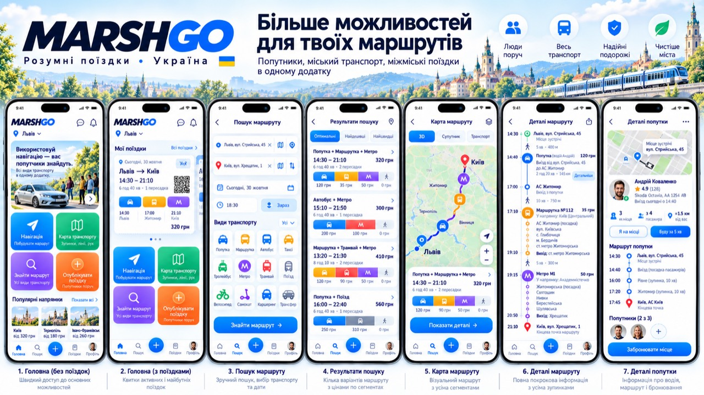

# MARSHGO canonical UI board — final owner reference, 2026-10-11

This final owner-provided board is the visual source of truth for the seven pictured mobile screens. It supersedes the older light/dark concept boards for these screens. Preserve the product rules in `docs/PRODUCT_CANON.md`; this visual reference does not authorize copying its illustrative sample names, fares, vehicle plates, ratings, route numbers, or trip data into production.

| # | Canonical screen | Implementation |
|---|---|---|
| 1 | Home without a trip | `HomeV5` |
| 2 | Home with an active or upcoming trip | `HomeV5` |
| 3 | Search route and choose transport | `SearchMapForm` |
| 4 | Search results, all available alternatives | `SearchResultsList` and `JourneyResultsPanel` |
| 5 | Selected journey on the map | `SearchMapDetails` / shared map mode |
| 6 | Route details timeline | `RouteDetailsView` |
| 7 | Carpool offer details and booking | `ProductionMarketplace` selected-offer detail |

## Visual language for every screen

- Use the supplied light mobile design as the baseline: pale blue-gray page canvas, white rounded surfaces, dark navy headings, muted slate supporting text, MARSHGO blue primary actions, restrained shadows, and generous but compact spacing.
- Keep the existing optional dark theme structurally identical and readable. It uses dark navy surfaces and semantic equivalents; never invert map tiles or photos.
- Keep the five-position bottom bar fixed: `Головна | Пошук | + | Мої поїздки | Профіль`. The center action is prominent and must not make the bar jump when active state changes.
- Use consistent header spacing, card radii, border colors, typography, control heights, and focus/pressed states across sections, dialogs, empty states, and forms. Long lists and timelines scroll inside the page shell; the map pans and zooms inside its own viewport.
- On route chains, details, and maps, the same transport mode uses the same semantic color and icon. Use only geometry, stops, schedules, fares, live positions, ratings, and availability supplied by real APIs/providers.
- Show all returned route alternatives initially. Strategy controls rank the same results; explicit filters can narrow them. Label unknown fare, duration, or distance as unavailable instead of filling in sample values.
- Unsupported modes remain visible with an honest availability state. No decorative route line, stop, provider, realtime marker, fare, or successful booking may be presented as live data.

## Canonical screen composition

1. **Home without a trip:** brand header and city selector; a short landscape mobility hero; primary action tiles for navigation, transport map, search, and publishing; popular destination cards. Fit the content to the mobile viewport without page-level scrolling where the viewport permits.
2. **Home with a trip:** same hero and action grid, with a distinct green active/upcoming trip card between the hero and actions. The card is sourced from the signed-in user's actual trip/booking and opens that record.
3. **Search:** origin and destination fields with map/location/swap controls; date, time, passengers; the twelve canonical transport types from `docs/PRODUCT_CANON.md`; a single primary search action.
4. **Results:** selected A→B and departure context; strategy choices and filters; all returned route cards, showing the actual colored transport chain, duration, transfers, distance, and fare status. Keep map preview and list state linked to the selected result.
5. **Map:** draw each selected route segment using provider-supplied geometry and its transport-mode color. Keep map style controls and map actions legible. A selected route summary card shows the same segment chain and opens details; returning to alternatives restores the list.
6. **Details:** chronological, color-coded stop/transfer timeline, with actual time, stop, operator/route, walk segments, duration, distance and fare availability. Stop rows open real departures when supplied.
7. **Carpool detail:** actual pickup/drop-off points and route preview, driver identity/reputation when provided, vehicle and available-seat details, per-seat fare, seat selector and booking action. Preserve privacy and do not claim a booking succeeded until the API confirms it.

All remaining application pages should use this same component and token language while retaining their existing real data, permissions, and actions. A page that lacks an API-backed capability should show a clear unavailable or empty state in the same design system, not fabricated demo content.
