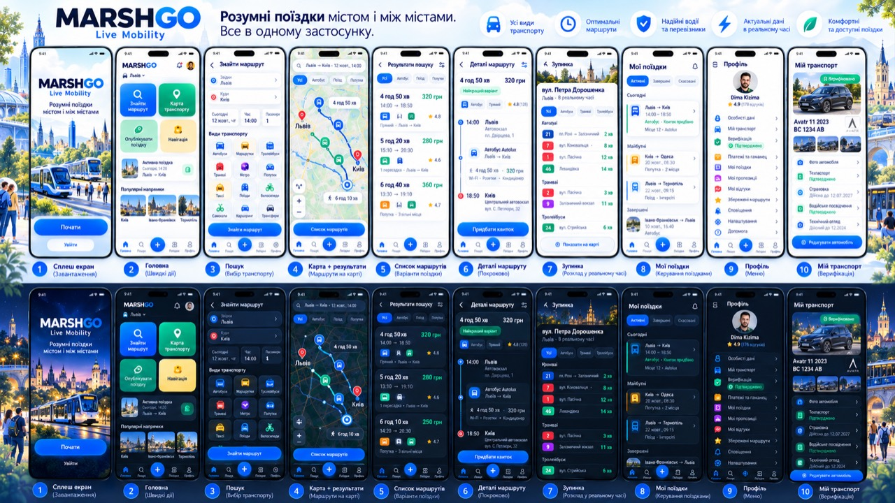

# MARSHGO canonical app board — previous ten-screen revision

This ten-screen board was the prior owner-approved reference and is retained for history. The current six-screen canonical board is in `CANONICAL_APP_BOARD_2026-10-11.md`. Sample names, times, fares, ratings, and vehicle details remain visual guidance only; runtime values must come from real account, route, stop, and provider data.

| # | Canonical screen | Implementation |
|---|---|---|
| 1 | Welcome / launch | Auth intro in `ProductionMarketplace` |
| 2 | Home | `HomeV5` |
| 3 | Search form and transport choice | `SearchMapForm` |
| 4 | Map with selected route chain | `SearchMapDetails` map mode |
| 5 | All search alternatives | `SearchResultsList` |
| 6 | Route details timeline | `RouteDetailsView` |
| 7 | Stop departures and stop information | `StopDeparturesModal` |
| 8 | My trips | `IdenticalTripsExperience` |
| 9 | Profile | `IdenticalProfileExperience` |
| 10 | My transport and verification | `IdenticalProfileExperience` vehicle view |

## Canonical visual rules

- Carry the same MARSHGO identity, rounded surfaces, readable type, blue action color, and fixed five-position bottom navigation through every screen.
- Keep light and dark themes visually parallel. Use the same transport-mode color for a route leg in its map line, mode icon, and route-chain chip.
- Show the complete set of returned route options at once. Strategy selection and filters change or rank that real set; they must not replace missing provider data with invented results.
- Keep map screens fixed to the viewport above bottom navigation. Let the map itself pan and zoom; allow scrolling only inside route lists, details, and long forms.

## Screen layout

- **Home:** compact city selector; two-by-two quick actions in this order: find route, transport map, publish trip, navigation. Use the real active booking or journey when one exists. Follow it with popular destination shortcuts and the fixed bottom bar. The page fits the mobile viewport without document scrolling.
- **Search:** origin and destination, date/time/passengers, and transport-mode selection; preserve place search, source/filter controls, and the real journey-search submit path.
- **Map and results:** show origin/destination markers, every returned route chain with matching mode colors, route duration, distance, fare when supplied, transfers, and source freshness. Missing data stays explicitly unavailable.
- **Route details:** render the same selected chain as a chronological, color-coded timeline with real stop/transfer details and a map action.
- **Stop:** show the stop identity, transport-mode filters, and arrivals labeled as live, forecast, or schedule according to provider data.
- **My trips:** active, scheduled, and cancelled views; display only server-backed bookings, offers, and stored journeys.
- **Profile:** real account identity and verification state followed by compact account rows. Omit unavailable ratings or payment state instead of inventing them.
- **Vehicle:** use only uploaded vehicle photos and server-backed vehicle/document verification states.
