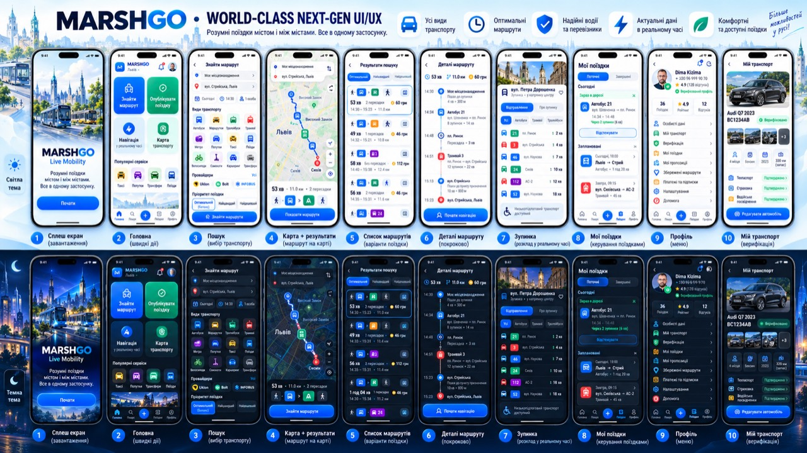

# MARSHGO canonical app board — 2026-10-11

This owner-provided board is the visual reference for the ten production screens in both themes. Keep the shared MARSHGO header, five-position bottom navigation, blue/navy palette, rounded white surfaces, route-mode colors, and information hierarchy consistent across screens. The data shown in the app must still come from the live API; sample text or values from the board are visual guidance, not application data.

| Board | Screen | Existing implementation |
|---|---|---|
| 1 | Welcome / launch | Auth intro in `ProductionMarketplace` |
| 2 | Home | `HomeV5` |
| 3 | Search and transport choice | `SearchMapForm` |
| 4 | Route map with selected chain | `SearchMapDetails` map mode |
| 5 | Search results and route alternatives | `SearchResultsList` |
| 6 | Route detail timeline | `RouteDetailsView` |
| 7 | Stop departures and stop information | `StopDeparturesModal` |
| 8 | My trips | `IdenticalTripsExperience` |
| 9 | Profile | `IdenticalProfileExperience` |
| 10 | My transport and verification | `IdenticalProfileExperience` vehicle view |

The screen layout and colors follow the board in light and dark themes. Route legs use the same mode color in result chips, detail timelines, and map segments. Map and route screens occupy the space above the fixed bottom navigation; page scrolling is reserved for long lists and form content.

## Layout details to preserve

- **Home:** shared brand header with notifications and the real profile image, then a two-by-two action grid in this order: find a route, publish a trip, navigation, transport map. Follow it with the popular services row, a shallow city panorama, and the fixed five-position bottom bar. Keep this view within the mobile viewport without page scrolling.
- **My trips:** title, current/completed segmented control, today/active trip summary, then scheduled or previous trips. Additional offers, requests, saved routes, and history remain accessible from the secondary sections.
- **Profile:** real account identity first, then compact rows for personal data, transport, verification, trips, and account settings. Vehicle photos, reputation, and verification states must come from the account API; omit unavailable values.
- **Vehicle:** use the account's primary vehicle photo as the large lead image; show only uploaded photos and server-backed vehicle/document states.
